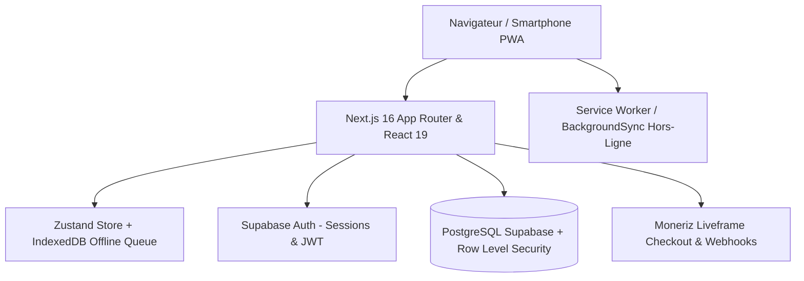

# 📘 MonBudget — Documentation Complète de l'Application

> **MonBudget** est une application web progressive (PWA) de gestion budgétaire personnelle, familiale et d'éducation financière, pensée pour s'adapter aux réalités africaines et internationales (gestion native du **FCFA**, devises internationales, date de paie configurable, gestion des tontines, dettes et solidarité).

---

## 📑 Sommaire

1. [Vision & Philosophie du Produit](#-1-vision--philosophie-du-produit)
2. [Architecture Technique & Stack](#-2-architecture-technique--stack)
3. [Les Piliers Fonctionnels](#-3-les-piliers-fonctionnels)
   - [Pilier 1 : Revenus & Date de Paie](#pilier-1--revenus--date-de-paie)
   - [Pilier 2 : Enveloppes Budgétaires](#pilier-2--enveloppes-budgétaires)
   - [Pilier 3 : Journal des Transactions](#pilier-3--journal-des-transactions)
   - [Pilier 4 : Épargne & Objectifs (Règle Fondamentale)](#pilier-4--épargne--objectifs)
   - [Pilier 5 : Dettes & Créances](#pilier-5--dettes--créances)
   - [Pilier 6 : Conseiller IA Financier & Budget Journalier](#pilier-6--conseiller-ia-financier--budget-journalier)
4. [Formules Comptables & Règles Métier](#-4-formules-comptables--règles-métier)
5. [Mode Hors-Ligne & PWA (Progressive Web App)](#-5-mode-hors-ligne--pwa)
6. [Thèmes Visuels (Clair, Sombre, Système)](#-6-thèmes-visuels)
7. [Sécurité & Confidentialité](#-7-sécurité--confidentialité)
8. [Support Client & Assistance WhatsApp](#-8-support-client--assistance-whatsapp)
9. [Tâches Automatisées en Arrière-Plan (Vercel Cron Jobs)](#-9-tâches-automatisées-en-arrière-plan-vercel-cron-jobs)
10. [Système d'Emails Transactionnels (Architecture Résiliente Resend)](#-10-système-demails-transactionnels-architecture-résiliente-resend)
11. [Justificatifs de Dépenses & Upload de Reçus](#-11-justificatifs-de-dépenses--upload-de-reçus)
12. [Espace Administrateur & Gouvernance SaaS (`/admin`)](#-12-espace-administrateur--gouvernance-saas-admin)
13. [Sauvegarde & Portabilité des Données (Export Intégral JSON)](#-13-sauvegarde--portabilité-des-données-export-intégral-json)
14. [Assistance & Support Client Multi-Canal](#-14-assistance--support-client-multi-canal)
15. [Guide d'Installation & Commandes Développeur](#-15-guide-dinstallation--commandes-développeur)
16. [Architecture & Expérience Mobile-First](#-16-architecture--expérience-mobile-first)
17. [Identité Visuelle & Nouveau Branding Officiel](#-17-identité-visuelle--nouveau-branding-officiel)
18. [Abonnements, Essai 30 Jours & Paiements Moneriz](#-18-abonnements-essai-30-jours--paiements-moneriz)

---

## 🌟 1. Vision & Philosophie du Produit

La plupart des applications budgétaires occidentales sont conçues autour d'un calendrier fixe (du 1er au 31 du mois) et d'un compte bancaire unique. 

**MonBudget** a été pensé pour répondre aux réalités concrètes :
- **Rythme calqué sur la date de paie** : la majorité des salariés et travailleurs perçoivent leur salaire vers le 25 ou 28 du mois. MonBudget calcule les cycles financiers et le budget quotidien jusqu'à la *vraie* prochaine paie.
- **Réalités culturelles & Solidarité** : prise en compte naturelle des soutiens familiaux, de la dîme/solidarité et des tontines.
- **Principe de l'Épargne Réalisée** : dans MonBudget, **l'argent mis de côté est immédiatement considéré comme une dépense/allocation sortie de caisse**. Cela évite l'illusion financière d'avoir un solde disponible trompeur et empêche de dépenser ce qui a été économisé.
- **Multi-devises** : prise en charge native du **FCFA** (sans décimales superflues avec séparateurs de milliers clairs), de l'Euro (€) et du Dollar ($).

---

## 🛠 2. Architecture Technique & Stack



- **Frontend Framework** : [Next.js 16](https://nextjs.org/) (App Router, Turbopack, React 19).
- **Langage** : TypeScript avec vérification stricte des types.
- **Styling & UI** : Tailwind CSS, animations fluides, Base UI / Radix Primitives, Lucide Icons.
- **Gestion d'État & Hors-Ligne** : [Zustand](https://github.com/pmndrs/zustand) couplé à **IndexedDB** ([`src/lib/offline/db.ts`](file:///home/fideleatchade/.gemini/antigravity-ide/brain/e0d28ad8-ac41-492c-a977-6f3fe6e34690/MonBudget/src/lib/offline/db.ts)), moteur de synchronisation (`src/lib/offline/sync-engine.ts`), file d'attente persistante et endpoint `/api/offline/sync`.
- **Backend & Base de Données** : [Supabase](https://supabase.com/) (PostgreSQL 15+, Row Level Security - RLS).
- **Monétisation & Paiements** : Offre d'essai 30 jours, contrôle d'accès par formule ([`src/lib/moneriz-plans.ts`](file:///home/fideleatchade/.gemini/antigravity-ide/brain/e0d28ad8-ac41-492c-a977-6f3fe6e34690/MonBudget/src/lib/moneriz-plans.ts)) et paiement intégré **Moneriz** (`/api/checkout`, `/api/webhooks/moneriz`).
- **PWA & Mobilité** : Manifeste PWA complet (`manifest.json`), Service Worker (`sw.js`), BackgroundSync et écran de secours hors-ligne (`offline.html`).
- **Tests & Assurance Qualité** : Suite automatisée [Playwright](https://playwright.dev/) couvrant calculs financiers (`budget-calc.spec.ts`), sécurité (`security.spec.ts`), mode hors-ligne (`offline-first.spec.ts`), paiements (`moneriz.spec.ts`), emails, reçus, exports et support.

---

## 🏛 3. Les Piliers Fonctionnels

### Pilier 1 : Revenus & Date de Paie
- **Revenu Principal & Multi-Sources** : Enregistrement du salaire de base et de sources complémentaires (primes, ventes, activités secondaires, allocations).
- **Jour de Paie Configurable** : Paramétrable dans les réglages (par défaut le 28 de chaque mois).
- **Compte à Rebours** : Affichage dynamique du nombre de jours restants avant la prochaine paie.

### Pilier 2 : Enveloppes Budgétaires
- Inspiré de la méthode des enveloppes et du ratio **50 / 30 / 20** :
  - **50% Besoins essentiels** (Loyer, Factures, Nourriture, Transports).
  - **30% Envies & Confort** (Sorties, Loisirs, Vêtements).
  - **20% Épargne, Dette & Projets** (Fonds d'urgence, remboursements).
- **Alertes Seuil à 80%** : notification visuelle dès qu'une enveloppe atteint 80% de son plafond prévisionnel pour prévenir tout dépassement.

### Pilier 3 : Journal des Transactions
- Saisie instantanée des entrées (revenus supplémentaires) et sorties (dépenses quotidiennes).
- Déduction immédiate sur l'enveloppe correspondante.
- Filtrage par mois, par type et recherche textuelle.

### Pilier 4 : Épargne & Objectifs
- Création d'objectifs avec montant cible, date souhaitée et barre de progression.
- **Règle Comptable Clé** : Tout versement vers une épargne :
  1. Incrémente le montant épargné de l'objectif.
  2. Génère une transaction catégorisée en « Épargne ».
  3. **Est comptabilisé dans les Dépenses Totales Réalisées**.
  4. **Est déduit immédiatement du Solde Disponible en Caisse**.
  *(Résultat : le solde en caisse correspond exactement à ce qu'il reste à vivre sans toucher à l'épargne).*

### Pilier 5 : Dettes & Créances
- Suivi clair et bilatéral :
  - **Ce que je dois** (Dettes passives à rembourser avec échéancier).
  - **Ce qu'on me doit** (Créances actives à récupérer avec coordonnées du débiteur).
- Alertes automatiques 7 jours avant chaque échéance.
- Solde net de la position d'endettement.

### Pilier 6 : Conseiller IA Financier & Budget Journalier
- **Budget Journalier Conseillé Dégressif** : Calcule le montant quotidien maximal recommandé pour tenir sereinement jusqu'à la paie :
  $$\text{Budget Journalier} = \frac{\text{Reste à Vivre}}{\text{Jours avant la Paie}}$$
- Déduction automatique des dépenses effectuées le jour même en temps réel.
- **Score de Santé Financière (0 à 100)** et recommandations d'optimisation générées selon les critères de bon sens et les ratios de prudence.

---

## 📐 4. Formules Comptables & Règles Métier

Toutes les formules sont centralisées dans [`src/lib/utils/budget-calc.ts`](file:///home/fideleatchade/.gemini/antigravity-ide/brain/e0d28ad8-ac41-492c-a977-6f3fe6e34690/MonBudget/src/lib/utils/budget-calc.ts) et testées unitairement :

### 1. Dépenses Totales Réalisées
$$\text{Dépenses Totales} = \text{Dépenses Courantes} + \max(\text{Épargne Mensuelle},\, \text{Transactions Épargne})$$
*La fonction `max()` empêche tout double comptage entre un objectif d'épargne et sa transaction liée.*

### 2. Solde Réel en Caisse (Reste à Vivre)
$$\text{Solde Disponible} = \text{Revenus Totaux} - \text{Dépenses Totales Réalisées}$$

### 3. Reste à Allouer
$$\text{Reste à Allouer} = \text{Revenus Totaux} - \text{Dépenses Prévues dans les Enveloppes}$$

---

## 📱 5. Mode Hors-Ligne & PWA

MonBudget est certifié **Progressive Web App (PWA)** autonome, optimisée pour un usage hors-ligne complet et installable en quelques secondes :

### Sélecteur d'Appareil Interactif ([`src/components/pwa/install-button.tsx`](file:///home/fideleatchade/.gemini/antigravity-ide/brain/e0d28ad8-ac41-492c-a977-6f3fe6e34690/MonBudget/src/components/pwa/install-button.tsx))
La modale d'installation propose une sélection dynamique adaptée à l'équipement de l'utilisateur :
- **Détection Automatique de l'OS** : L'application détecte automatiquement la plateforme en cours d'utilisation (`navigator.userAgent`) et applique un badge visuel vert *« Votre appareil »* sur la carte correspondante.
- **Trois Modes Sélectionnables** :
  1. 💻 **Sur Ordinateur (Chrome, Edge, Brave)** : Explique l'icône dans la barre d'adresse et le raccourci menu.
  2. 📱 **Sur Android (Chrome)** : Affiche un bouton d'action directe en 1 clic (*« Lancer l'installation sur Android maintenant »*) déclenchant l'invite native `beforeinstallprompt`, ainsi que la procédure alternative via le menu contextuel.
  3. 🍏 **Sur iPhone / iPad (Safari)** : Affiche la démarche guidée spécifique à iOS (*Bouton Partager* $\rightarrow$ *Sur l'écran d'accueil*).
- **Architecture Offline-First Durcie (IndexedDB & Sync Engine)** :
  - **Base locale IndexedDB ([`src/lib/offline/db.ts`](file:///home/fideleatchade/.gemini/antigravity-ide/brain/e0d28ad8-ac41-492c-a977-6f3fe6e34690/MonBudget/src/lib/offline/db.ts))** : chaque ajout, modification ou suppression hors connexion est enregistré localement avec partitionnement par utilisateur et marqueurs de suppression (*tombstones*).
  - **Moteur de synchronisation & BackgroundSync ([`src/lib/offline/sync-engine.ts`](file:///home/fideleatchade/.gemini/antigravity-ide/brain/e0d28ad8-ac41-492c-a977-6f3fe6e34690/MonBudget/src/lib/offline/sync-engine.ts))** : au retour d'Internet (ou sur clic manuel), la file d'attente est rejouée automatiquement vers `/api/offline/sync` avec gestion des sessions expirées (`auth_expired`).
  - **Résolution Manuelle des Conflits** : lorsqu'une même donnée a été modifiée en parallèle hors-ligne et sur le serveur, un lien direct dirige l'utilisateur vers `/settings?tab=security#conflicts-review` pour arbitrer sans perte de données.
  - **Pastille d'État Réseau ([`src/components/pwa/network-status.tsx`](file:///home/fideleatchade/.gemini/antigravity-ide/brain/e0d28ad8-ac41-492c-a977-6f3fe6e34690/MonBudget/src/components/pwa/network-status.tsx))** : affiche en direct l'état (*En ligne*, *Hors-ligne*, *Synchronisation…*, *En attente*, *Session expirée*, *Erreur de synchro*), le compteur d'opérations en file et un popover de synchronisation manuelle.

---

## 🎨 6. Thèmes Visuels

L'application intègre un sélecteur de thème complet :
- ☀️ **Clair (Light)** : Interface moderne et lumineuse.
- 🌙 **Sombre (Dark)** : Palette nuit optimisée (Slate 900 / 950) pour le repos des yeux et l'économie de batterie sur écran OLED.
- 💻 **Système** : S'adapte automatiquement aux préférences de l'appareil de l'utilisateur.

---

## 🛡 7. Sécurité, Profil & Authentification

- **Menu Profil Utilisateur & Déconnexion Multi-Plateforme ([`src/components/layout/user-menu.tsx`](file:///home/fideleatchade/.gemini/antigravity-ide/brain/e0d28ad8-ac41-492c-a977-6f3fe6e34690/MonBudget/src/components/layout/user-menu.tsx))** :
  - Intégré dans l'en-tête supérieur ([`src/components/layout/header.tsx`](file:///home/fideleatchade/.gemini/antigravity-ide/brain/e0d28ad8-ac41-492c-a977-6f3fe6e34690/MonBudget/src/components/layout/header.tsx)) et la barre latérale ([`src/components/layout/sidebar.tsx`](file:///home/fideleatchade/.gemini/antigravity-ide/brain/e0d28ad8-ac41-492c-a977-6f3fe6e34690/MonBudget/src/components/layout/sidebar.tsx)).
  - Affiche les identifiants de l'utilisateur (avatar, nom, adresse email, badge de statut/rôle administrateur).
  - Offre un accès rapide aux Paramètres, au Support client et à la documentation.
  - Comporte un bouton **« Déconnexion »** rouge entièrement fonctionnel sur mobile et desktop qui invoque `supabase.auth.signOut()`, purge les états de session sensibles et redirige instantanément vers la page de connexion.
- **Isolation Stricte des Utilisateurs (Row Level Security)** : Chaque table PostgreSQL Supabase (`budgets`, `transactions`, `savings_goals`, `debts`) applique une politique RLS interdisant tout accès aux données d'un autre utilisateur :
  ```sql
  CREATE POLICY "Users can only manage their own data"
    ON transactions FOR ALL
    USING (auth.uid() = user_id);
  ```
- **Clés de Stockage Partitionnées** : Le cache local isole les données par identifiant utilisateur (`user_${userId}_data`) pour éviter toute fuite lors d'une déconnexion/reconnexion sur un appareil partagé.
- **Protection Open Redirect** : Validation stricte des URL de redirection lors de l'authentification et de la réinitialisation de mot de passe.
- **Headers HTTP Sécurisés** : CSP, HSTS, X-Content-Type-Options, X-Frame-Options configurés dans [`next.config.ts`](file:///home/fideleatchade/.gemini/antigravity-ide/brain/e0d28ad8-ac41-492c-a977-6f3fe6e34690/MonBudget/next.config.ts).

---

## 💬 8. Support Client & Assistance WhatsApp

MonBudget intègre une assistance directe pour accompagner les utilisateurs au quotidien :
- **Bouton WhatsApp Flottant** : Présent en bas à droite sur les pages publiques (`/`, `/support`), il permet de contacter en 1 clic le support au **`+228 98 37 61 01`** avec un message d'accueil pré-configuré.
- **Centre d'Assistance Dédié (`/support`)** : Page complète regroupant les coordonnées directes (WhatsApp, téléphone, email), les horaires d'assistance (7j/7) et les réponses aux questions techniques fréquentes (installation PWA, sécurité, fonctionnement hors-ligne).

---

## ⏰ 9. Tâches Automatisées en Arrière-Plan (Vercel Cron Jobs)

MonBudget est équipé d'un système de veille automatique planifié dans [`vercel.json`](file:///home/fideleatchade/.gemini/antigravity-ide/brain/e0d28ad8-ac41-492c-a977-6f3fe6e34690/MonBudget/vercel.json) :
- **Audit Financier Nocturne (`/api/cron/daily-check`)** : Déclenché automatiquement chaque nuit à 00:00 UTC (`0 0 * * *`).
  - Détection proactive des dettes arrivant à échéance sous 7 jours (J-7) ou dépassées.
  - Préparation du renouvellement mensuel le 1er de chaque mois.
- **Sécurité Cryptographique** : L'accès à la route cron est strictement verrouillé par le token d'autorisation `CRON_SECRET` (`Authorization: Bearer <CRON_SECRET>`), bloquant toute tentative d'exécution non autorisée.

---

## 📧 10. Système d'Emails Transactionnels (Architecture Résiliente Resend)

MonBudget intègre une infrastructure de communication par email optimisée et sécurisée :
- **Service d'Envoi Résilient ([`src/lib/email/service.ts`](file:///home/fideleatchade/.gemini/antigravity-ide/brain/e0d28ad8-ac41-492c-a977-6f3fe6e34690/MonBudget/src/lib/email/service.ts))** : Connexion directe à l'API Resend avec fallback gracieux (simulation locale sans crash si `RESEND_API_KEY` n'est pas configuré).
- **Templates HTML Responsives & Brandés ([`src/lib/email/templates.ts`](file:///home/fideleatchade/.gemini/antigravity-ide/brain/e0d28ad8-ac41-492c-a977-6f3fe6e34690/MonBudget/src/lib/email/templates.ts))** :
  - *Bienvenue* : Accueil personnalisé, conseils de démarrage et rappel du support WhatsApp.
  - *Alertes Budgétaires* : Notification visuelle immédiate au seuil de 80% (orange) ou dépassement 100% (rouge) avec barre de progression.
  - *Bilan Financier Mensuel* : Récapitulatif consolidé des revenus, dépenses réelles, épargne sécurisée et solde restant.

---

## 📎 11. Justificatifs de Dépenses & Upload de Reçus

MonBudget permet aux utilisateurs de photographier ou joindre leurs tickets de caisse et factures lors de l'enregistrement de dépenses :
- **Compression Côté Client ([`src/lib/utils/receipt-storage.ts`](file:///home/fideleatchade/.gemini/antigravity-ide/brain/e0d28ad8-ac41-492c-a977-6f3fe6e34690/MonBudget/src/lib/utils/receipt-storage.ts))** :
  - Réduction automatique des photos smartphone (~5 Mo) à ~150-300 Ko (-90% de poids) via Canvas HTML5 avant l'envoi réseau.
  - Économie maximale de forfait internet mobile pour les utilisateurs en Afrique.
- **Sécurité & Isolation Strictes** :
  - Formats acceptés : JPEG, PNG, WebP et PDF jusqu'à 5 Mo.
  - Assainissement cryptographique des noms de fichiers contre les attaques de type path traversal.
  - Partitionnement des dossiers de stockage par utilisateur : `receipts/{userId}/{year}-{month}/{transactionId}_{timestamp}_{filename}`.
- **Expérience Utilisateur & Visualisation ([`src/components/transactions/receipt-upload.tsx`](file:///home/fideleatchade/.gemini/antigravity-ide/brain/e0d28ad8-ac41-492c-a977-6f3fe6e34690/MonBudget/src/components/transactions/receipt-upload.tsx))** :
  - Prise de photo directe avec la caméra du smartphone ou sélection de fichier.
  - Badge interactif « Reçu » dans l'historique des transactions ouvrant un aperçu plein écran (lightbox) en 1 clic.

---

## 🛡️ 12. Espace Administrateur & Gouvernance SaaS (`/admin`)

MonBudget intègre un espace de direction réservé aux administrateurs pour piloter la plateforme en direct :
- **Contrôle d'Accès Cryptographique & Rôles ([`src/lib/utils/admin.ts`](file:///home/fideleatchade/.gemini/antigravity-ide/brain/e0d28ad8-ac41-492c-a977-6f3fe6e34690/MonBudget/src/lib/utils/admin.ts))** :
  - Autorisation par liste d'emails (`ADMIN_EMAILS` et emails de direction par défaut).
  - Blocage automatique des utilisateurs standards avec redirection immédiate vers `/dashboard`.
  - Lien discret dans la barre de navigation ([`src/components/layout/sidebar.tsx`](file:///home/fideleatchade/.gemini/antigravity-ide/brain/e0d28ad8-ac41-492c-a977-6f3fe6e34690/MonBudget/src/components/layout/sidebar.tsx)) affiché uniquement si l'utilisateur est administrateur.
- **Tableau de Bord des Métriques Globales ([`src/app/(dashboard)/admin/page.tsx`](file:///home/fideleatchade/.gemini/antigravity-ide/brain/e0d28ad8-ac41-492c-a977-6f3fe6e34690/MonBudget/src/app/(dashboard)/admin/page.tsx))** :
  - Compteurs KPI en temps réel : Utilisateurs inscrits, Budgets actifs, Transactions enregistrées, Objectifs d'épargne et créances.
  - Table des derniers membres inscrits avec date d'inscription et devise.
  - Surveillance d'infrastructure (base Supabase, audit nocturne Cron 00:00 UTC, connecteur emails Resend).
  - Déclenchement manuel de l'audit financier nocturne à la demande pour tests.

---

## 💾 13. Sauvegarde & Portabilité des Données (Export Intégral JSON)

MonBudget garantit la souveraineté et la portabilité intégrale des données pour chaque utilisateur (norme RGPD & sérénité financière) :
- **Consolidateur Universel ([`src/lib/utils/account-export.ts`](file:///home/fideleatchade/.gemini/antigravity-ide/brain/e0d28ad8-ac41-492c-a977-6f3fe6e34690/MonBudget/src/lib/utils/account-export.ts))** :
  - Rassemble l'intégralité des données en 1 seul fichier standard JSON horodaté : `MonBudget_Sauvegarde_Integrale_AAAA-MM-JJ.json`.
  - Contient : profil, préférences, tous les mois budgétisés, enveloppes de dépenses, toutes les transactions avec liens des reçus, objectifs d'épargne avec leurs versements, et dettes/créances avec leurs remboursements.
- **Accès en 1 Clic dans les Paramètres ([`src/app/(dashboard)/settings/page.tsx`](file:///home/fideleatchade/.gemini/antigravity-ide/brain/e0d28ad8-ac41-492c-a977-6f3fe6e34690/MonBudget/src/app/(dashboard)/settings/page.tsx))** :
  - Section dédiée dans l'onglet **Sécurité** permettant le téléchargement instantané et sécurisé sans dépendance de serveur tiers.

---

## 🎧 14. Assistance & Support Client Multi-Canal

MonBudget propose un écosystème d'assistance conçu pour être immédiatement accessible et réactif :
- **Page Support Dédiée ([`src/app/(marketing)/support/page.tsx`](file:///home/fideleatchade/.gemini/antigravity-ide/brain/e0d28ad8-ac41-492c-a977-6f3fe6e34690/MonBudget/src/app/(marketing)/support/page.tsx))** :
  - Carte WhatsApp prioritaire avec redirection instantanée pré-remplie (`+228 98 37 61 01`).
  - FAQ interactive répondant aux questions fréquentes (sécurité des données, calculs du budget, mode hors-ligne, multi-devises).
  - Canaux email officiels et tutoriel d'installation PWA mobile.
- **Formulaire de Contact Direct & API ([`src/components/support/support-form.tsx`](file:///home/fideleatchade/.gemini/antigravity-ide/brain/e0d28ad8-ac41-492c-a977-6f3fe6e34690/MonBudget/src/components/support/support-form.tsx) & [`src/app/api/support/route.ts`](file:///home/fideleatchade/.gemini/antigravity-ide/brain/e0d28ad8-ac41-492c-a977-6f3fe6e34690/MonBudget/src/app/api/support/route.ts))** :
  - Saisie intuitive du nom, email, sujet et description de la demande.
  - Double action : **Envoi immédiat par email** (acheminé via le service Resend à `support@monbudget.app`) ou **Bascule en 1 clic vers WhatsApp** avec message pré-formaté.
- **Accessibilité Universelle dans l'Application** :
  - Entrée directe « **Aide & Support** » dans la barre de navigation latérale ([`src/components/layout/sidebar.tsx`](file:///home/fideleatchade/.gemini/antigravity-ide/brain/e0d28ad8-ac41-492c-a977-6f3fe6e34690/MonBudget/src/components/layout/sidebar.tsx)) et le menu mobile.
  - Bouton flottant d'assistance WhatsApp ([`src/components/common/whatsapp-button.tsx`](file:///home/fideleatchade/.gemini/antigravity-ide/brain/e0d28ad8-ac41-492c-a977-6f3fe6e34690/MonBudget/src/components/common/whatsapp-button.tsx)) intégré de manière non-obstruante sur l'ensemble du tableau de bord ([`src/app/(dashboard)/layout.tsx`](file:///home/fideleatchade/.gemini/antigravity-ide/brain/e0d28ad8-ac41-492c-a977-6f3fe6e34690/MonBudget/src/app/(dashboard)/layout.tsx)).

---

## 🚀 15. Guide d'Installation & Commandes Développeur

### Prérequis
- Node.js 20+ (Node.js 22+ recommandé)
- npm ou pnpm

### Installation

```bash
# 1. Cloner le projet
git clone https://github.com/duxfidele/Monbudget.git
cd MonBudget

# 2. Installer les dépendances
npm install

# 3. Configurer l'environnement (.env.local)
cp .env.example .env.local
# Renseigner NEXT_PUBLIC_SUPABASE_URL et NEXT_PUBLIC_SUPABASE_ANON_KEY
```

### Commandes Principales

```bash
# Démarrer le serveur de développement Next.js (port 3000)
npm run dev

# Vérification des types TypeScript
npx tsc --noEmit

# Exécution des tests Playwright principaux (calculs, sécurité, hors-ligne, paiements Moneriz, emails, reçus, admin, export, support, légal)
npx playwright test tests/budget-calc.spec.ts tests/security.spec.ts tests/offline-first.spec.ts tests/moneriz.spec.ts tests/email.spec.ts tests/receipts.spec.ts tests/admin.spec.ts tests/export.spec.ts tests/support.spec.ts tests/legal.spec.ts

# Compiler pour la production
npm run build
```

---

## 📱 16. Architecture & Expérience Mobile-First

MonBudget a été pensé et restructuré comme une application native pour smartphone, utilisable d'une seule main :

### Ergonomie de la Zone du Pouce (*Thumb Zone*)
- **Barre de Navigation Basse Réorganisée ([`src/components/layout/bottom-nav.tsx`](file:///home/fideleatchade/.gemini/antigravity-ide/brain/e0d28ad8-ac41-492c-a977-6f3fe6e34690/MonBudget/src/components/layout/bottom-nav.tsx))** :
  - 4 onglets majeurs équilibrés : **Accueil**, **Budget**, **Mouvements** et **Épargne**.
  - **Bouton Flottant Central Surélevé `+`** : Un FAB (*Floating Action Button*) aux couleurs du dégradé officiel, surélevé au centre de la barre pour enregistrer une opération en 2 secondes depuis n'importe quelle vue de l'application.

### Boîte de Dialogue Universelle d'Ajout Rapide ([`src/components/transactions/quick-add-transaction-dialog.tsx`](file:///home/fideleatchade/.gemini/antigravity-ide/brain/e0d28ad8-ac41-492c-a977-6f3fe6e34690/MonBudget/src/components/transactions/quick-add-transaction-dialog.tsx))
- **Pavé Numérique Optimisé** : Champ montant à typographie géante avec `inputMode="decimal"` pour faire apparaître directement le pavé numérique avec virgule sur Android et iOS.
- **Sélecteur Segmenté Dépense / Revenu** : Bascule tactile instantanée entre sortie d'argent ou rentrée imprévue.
- **Scan & Pièce Jointe** : Intégration du composant de scan de reçu ([`src/components/transactions/receipt-upload.tsx`](file:///home/fideleatchade/.gemini/antigravity-ide/brain/e0d28ad8-ac41-492c-a977-6f3fe6e34690/MonBudget/src/components/transactions/receipt-upload.tsx)) permettant la capture photo immédiate.

### Modales en Feuilles Basses (*Native Bottom Sheets*) ([`src/components/ui/dialog.tsx`](file:///home/fideleatchade/.gemini/antigravity-ide/brain/e0d28ad8-ac41-492c-a977-6f3fe6e34690/MonBudget/src/components/ui/dialog.tsx))
- Sur écran mobile (`max-sm:`), les fenêtres modales ne s'affichent plus au centre de l'écran mais glissent depuis le bas (*slide-up*) jusqu'à un maximum de 92% de la hauteur de l'écran.
- Présence d'une poignée tactile d'accroche supérieure (*pill handle*) invitant naturellement au geste de balayage.

### Grille KPI 2x2 Sans Défilement ([`src/app/(dashboard)/dashboard/page.tsx`](file:///home/fideleatchade/.gemini/antigravity-ide/brain/e0d28ad8-ac41-492c-a977-6f3fe6e34690/MonBudget/src/app/(dashboard)/dashboard/page.tsx))
- Les indicateurs clés (Solde Réel, Budget Quotidien, Dépenses Totales, Épargne du Mois, Dettes à Payer, Créances à Récupérer) sont organisés en grille 2x2 compacte avec typographie contrastée, permettant de consulter l'état de santé financière sans défilement vertical interminable.

### En-tête Mobile à Deux Rangées & Actions Espacées ([`src/components/layout/header.tsx`](file:///home/fideleatchade/.gemini/antigravity-ide/brain/e0d28ad8-ac41-492c-a977-6f3fe6e34690/MonBudget/src/components/layout/header.tsx))
- Sur mobile (`< 640px`), l'en-tête adopte une structure sur deux niveaux pour supprimer tout chevauchement :
  - **Ligne 1** : menu hamburger + logo compact (libellé masqué sous `410px`) à gauche, et barre d'actions espacées (`gap-2 sm:gap-3`) à droite regroupant [`NetworkStatus`](file:///home/fideleatchade/.gemini/antigravity-ide/brain/e0d28ad8-ac41-492c-a977-6f3fe6e34690/MonBudget/src/components/pwa/network-status.tsx), [`InstallButton`](file:///home/fideleatchade/.gemini/antigravity-ide/brain/e0d28ad8-ac41-492c-a977-6f3fe6e34690/MonBudget/src/components/pwa/install-button.tsx) (`36×36px` sur mobile), [`NotificationsBell`](file:///home/fideleatchade/.gemini/antigravity-ide/brain/e0d28ad8-ac41-492c-a977-6f3fe6e34690/MonBudget/src/components/notifications/notifications-bell.tsx), `ThemeToggle` et [`UserMenu`](file:///home/fideleatchade/.gemini/antigravity-ide/brain/e0d28ad8-ac41-492c-a977-6f3fe6e34690/MonBudget/src/components/layout/user-menu.tsx).
  - **Ligne 2** : barre secondaire dédiée centrant [`MonthSelector`](file:///home/fideleatchade/.gemini/antigravity-ide/brain/e0d28ad8-ac41-492c-a977-6f3fe6e34690/MonBudget/src/components/dashboard/month-selector.tsx) (`Nov. 2026` sur mobile / `Novembre 2026` sur écran large).
- Les menus déroulants et popovers de l'en-tête (`NetworkStatus`, notifications, sélecteur de mois, menu utilisateur) se positionnent à `top-[6.25rem]` sur mobile afin d'apparaître sous l'en-tête sans masquer la barre de mois.
- L'ensemble des pages du tableau de bord, tableaux, cartes, onglets et formulaires est conçu *mobile-first* sans débordement horizontal sur `360px+`.

### Prise en Compte des Spécificités Matérielles Mobiles
- **Safe Area Insets** : Déclaration de `viewportFit: "cover"` dans [`src/app/layout.tsx`](file:///home/fideleatchade/.gemini/antigravity-ide/brain/e0d28ad8-ac41-492c-a977-6f3fe6e34690/MonBudget/src/app/layout.tsx) et des utilitaires CSS `@utility pb-safe` / `pt-safe` pour respecter les barres de geste et encoches matérielles (iPhone Dynamic Island, caméras poinçons Android).
- **Suppression du Zoom Forcé iOS** : Règle CSS imposant une taille minimale de `16px` sur les champs `<input>` et `<textarea>` en dessous de 768px de largeur, empêchant iOS Safari de zoomer de force sur la page lors de la saisie.
- **Espacement de Sécurité Inférieur** : Marge de `pb-28` sur le corps de page du tableau de bord pour que le contenu ne soit jamais masqué par la barre de navigation basse ni par le bouton d'assistance WhatsApp.

---

## 🎨 17. Identité Visuelle & Nouveau Branding Officiel

MonBudget arbore une identité visuelle professionnelle et inspirante :

### Logo Officiel ([`public/logo.png`](file:///home/fideleatchade/.gemini/antigravity-ide/brain/e0d28ad8-ac41-492c-a977-6f3fe6e34690/MonBudget/public/logo.png))
- **Symbolisme** :
  - **Portefeuille en cuir bleu marine** : La sécurité, la gestion rigoureuse et la confiance.
  - **Billet vert FCFA & Pièce dorée** : Ancrage culturel direct dans la zone CFA (UEMOA / CEMAC), rappelant la gestion concrète de l'argent quotidien.
  - **Courbe ascendante et barres de progression** : La croissance du patrimoine, la réalisation des objectifs d'épargne et l'indépendance financière.
  - **Slogan** : *« Gérez mieux votre argent »*.

### Palette Graphique
| Rôle | Teinte | Code Hex | Usage |
| :--- | :--- | :--- | :--- |
| **Bleu Nuit Primaire** | Midnight Navy | `#1E3A5F` | En-têtes, boutons principaux, cartes d'action, accents de marque |
| **Émeraude** | Growth Emerald | `#10B981` | Revenus, budgets sous contrôle, validation, santé financière |
| **Or / Ambre** | Gold Amber | `#F59E0B` | Alertes budgétaires (80%), pièces FCFA, objectifs d'épargne |
| **Ciel / Cyan** | Electric Sky | `#0284C7` | Liens interactifs, boutons secondaires, mode sombre |
| **Rose / Rouge** | Critical Rose | `#EF4444` | Dépassements, dettes échues, déconnexion |

---

## 💳 18. Abonnements, Essai 30 Jours & Paiements Moneriz

MonBudget intègre un modèle freemium transparent piloté dans [`src/lib/moneriz-plans.ts`](file:///home/fideleatchade/.gemini/antigravity-ide/brain/e0d28ad8-ac41-492c-a977-6f3fe6e34690/MonBudget/src/lib/moneriz-plans.ts) :

### Grille Tarifaire Officielle (2 mois offerts sur la facturation annuelle)
| Formule | Tarif Mensuel | Tarif Annuel (10 mois) | Fonctionnalités incluses |
| :--- | :--- | :--- | :--- |
| **Gratuit (`free`)** | **0 FCFA** | **0 FCFA** | Saisie illimitée des revenus & dépenses, historique/recherche/filtrage, ajout rapide mobile (`+`), synchronisation cloud & mode hors-ligne |
| **Particulier (`personal`)** | **500 FCFA** | **5 000 FCFA** *(1 000 FCFA économisés)* | Tout du plan Gratuit + pilotage quotidien, enveloppes budgétaires & alertes 80%, épargne & cagnottes, dettes & créances (WhatsApp), rapports & exports PDF/CSV, reçus illimités, Conseiller IA |
| **Entreprise & Pro (`business`)** | **1 500 FCFA** *(configurable)* | **15 000 FCFA** *(3 000 FCFA économisés)* | Tout du plan Particulier + support prioritaire 7j/7 et accès anticipé aux futurs modules dédiés Entreprise (multi-caisses, bilans pro, équipe) |

> *Note :* Le tarif mensuel du plan Entreprise & Pro peut être ajusté sans modification de code via la variable `NEXT_PUBLIC_BUSINESS_MONTHLY_PRICE_XOF` (`1 500 FCFA` par défaut).

### Cycle d'Essai 30 Jours & Contrôle d'Accès
- **Essai Complet Automatique (`TRIAL_DURATION_DAYS = 30`)** : chaque nouvel utilisateur bénéficie pendant 30 jours de l'intégralité des fonctionnalités du plan Particulier (`Essai 30j Complet`).
- **Visibilité Permanente ([`src/components/layout/sidebar.tsx`](file:///home/fideleatchade/.gemini/antigravity-ide/brain/e0d28ad8-ac41-492c-a977-6f3fe6e34690/MonBudget/src/components/layout/sidebar.tsx))** : la barre latérale affiche le badge du forfait actif ainsi qu'une pastille haute visibilité indiquant le décompte complet (*« X jours restants »* / *« 1 jour restant »*).
- **Alertes & Fin d'Essai** : des notifications automatiques préviennent à **J-3** et **J0** (`/api/notifications`), puis à l'expiration l'utilisateur peut soit passer sur une formule payante, soit activer librement le plan **Gratuit** via `/api/subscription/choose-free` (les modules réservés affichent un verrouillage clair sans perte des transactions saisies).

### Paiement Intégré Moneriz (Liveframe In-App & Webhooks)
- **Liveframe In-App** : le règlement par Mobile Money ou carte bancaire s'ouvre directement dans l'application (routes `/api/checkout` et `/api/checkout/status`), puis redirige vers `/dashboard` avec notification de confirmation dès validation.
- **Sécurité Webhook** : la route `/api/webhooks/moneriz` vérifie la signature cryptographique Moneriz (`src/lib/server/moneriz-signature.ts`) avant d'activer ou renouveler l'abonnement côté Supabase.

---

*Document maintenu pour le projet MonBudget.*

