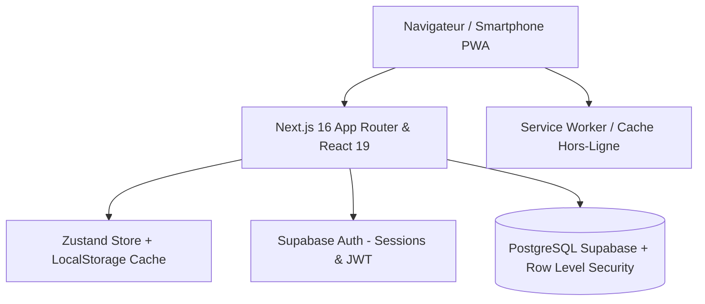

# 📘 MonBudget — Documentation Complète de l'Application

> **MonBudget** est une application web progressive (PWA) de gestion budgétaire personnelle, familiale et d'éducation financière, pensée pour s'adapter aux réalités africaines et internationales (gestion native du **FCFA**, devises internationales, date de paie configurable, gestion des tontines, dettes et solidarité).

---

## 📑 Sommaire

1. [Vision & Philosophie du Produit](#-1-vision--philosophie-du-produit)
2. [Architecture Technique & Stack](#-2-architecture-technique--stack)
3. [Les Piliers Fonctionnels](#-3-les-piliers-fonctionnels)
   - [Pilier 1 : Revenus & Date de Paie](#pilier-1--revenus--date-de-paie)
   - [Pilier 2 : Enveloppes Budgétaires](#pilier-2--enveloppes-budgétaires)
   - [Pilier 3 : Journal des Transactions](#pilier-3--journal-des-transactions)
   - [Pilier 4 : Épargne & Objectifs (Règle Fondamentale)](#pilier-4--épargne--objectifs)
   - [Pilier 5 : Dettes & Créances](#pilier-5--dettes--créances)
   - [Pilier 6 : Conseiller IA Financier & Budget Journalier](#pilier-6--conseiller-ia-financier--budget-journalier)
4. [Formules Comptables & Règles Métier](#-4-formules-comptables--règles-métier)
5. [Mode Hors-Ligne & PWA (Progressive Web App)](#-5-mode-hors-ligne--pwa)
6. [Thèmes Visuels (Clair, Sombre, Système)](#-6-thèmes-visuels)
7. [Sécurité & Confidentialité](#-7-sécurité--confidentialité)
8. [Guide d'Installation & Commandes Développeur](#-8-guide-dinstallation--commandes-développeur)

---

## 🌟 1. Vision & Philosophie du Produit

La plupart des applications budgétaires occidentales sont conçues autour d'un calendrier fixe (du 1er au 31 du mois) et d'un compte bancaire unique. 

**MonBudget** a été pensé pour répondre aux réalités concrètes :
- **Rythme calqué sur la date de paie** : la majorité des salariés et travailleurs perçoivent leur salaire vers le 25 ou 28 du mois. MonBudget calcule les cycles financiers et le budget quotidien jusqu'à la *vraie* prochaine paie.
- **Réalités culturelles & Solidarité** : prise en compte naturelle des soutiens familiaux, de la dîme/solidarité et des tontines.
- **Principe de l'Épargne Réalisée** : dans MonBudget, **l'argent mis de côté est immédiatement considéré comme une dépense/allocation sortie de caisse**. Cela évite l'illusion financière d'avoir un solde disponible trompeur et empêche de dépenser ce qui a été économisé.
- **Multi-devises** : prise en charge native du **FCFA** (sans décimales superflues avec séparateurs de milliers clairs), de l'Euro (€) et du Dollar ($).

---

## 🛠 2. Architecture Technique & Stack



- **Frontend Framework** : [Next.js 16](https://nextjs.org/) (App Router, Turbopack, React 19).
- **Langage** : TypeScript avec vérification stricte des types.
- **Styling & UI** : Tailwind CSS, animations fluides, Radix UI primitives, Lucide Icons.
- **Gestion d'État (State)** : [Zustand](https://github.com/pmndrs/zustand) avec persistance locale (`localStorage`) et synchronisation Supabase.
- **Backend & Base de Données** : [Supabase](https://supabase.com/) (PostgreSQL 15+, Row Level Security - RLS).
- **PWA & Mobilité** : Manifeste PWA complet (`manifest.json`), Service Worker (`sw.js`), écran de secours hors-ligne (`offline.html`).
- **Tests & Assurance Qualité** : Suite automatisée [Playwright](https://playwright.dev/) pour les tests de calculs financiers (`budget-calc.spec.ts`) et de sécurité (`security.spec.ts`).

---

## 🏛 3. Les Piliers Fonctionnels

### Pilier 1 : Revenus & Date de Paie
- **Revenu Principal & Multi-Sources** : Enregistrement du salaire de base et de sources complémentaires (primes, ventes, activités secondaires, allocations).
- **Jour de Paie Configurable** : Paramétrable dans les réglages (par défaut le 28 de chaque mois).
- **Compte à Rebours** : Affichage dynamique du nombre de jours restants avant la prochaine paie.

### Pilier 2 : Enveloppes Budgétaires
- Inspiré de la méthode des enveloppes et du ratio **50 / 30 / 20** :
  - **50% Besoins essentiels** (Loyer, Factures, Nourriture, Transports).
  - **30% Envies & Confort** (Sorties, Loisirs, Vêtements).
  - **20% Épargne, Dette & Projets** (Fonds d'urgence, remboursements).
- **Alertes Seuil à 80%** : notification visuelle dès qu'une enveloppe atteint 80% de son plafond prévisionnel pour prévenir tout dépassement.

### Pilier 3 : Journal des Transactions
- Saisie instantanée des entrées (revenus supplémentaires) et sorties (dépenses quotidiennes).
- Déduction immédiate sur l'enveloppe correspondante.
- Filtrage par mois, par type et recherche textuelle.

### Pilier 4 : Épargne & Objectifs
- Création d'objectifs avec montant cible, date souhaitée et barre de progression.
- **Règle Comptable Clé** : Tout versement vers une épargne :
  1. Incrémente le montant épargné de l'objectif.
  2. Génère une transaction catégorisée en « Épargne ».
  3. **Est comptabilisé dans les Dépenses Totales Réalisées**.
  4. **Est déduit immédiatement du Solde Disponible en Caisse**.
  *(Résultat : le solde en caisse correspond exactement à ce qu'il reste à vivre sans toucher à l'épargne).*

### Pilier 5 : Dettes & Créances
- Suivi clair et bilatéral :
  - **Ce que je dois** (Dettes passives à rembourser avec échéancier).
  - **Ce qu'on me doit** (Créances actives à récupérer avec coordonnées du débiteur).
- Alertes automatiques 7 jours avant chaque échéance.
- Solde net de la position d'endettement.

### Pilier 6 : Conseiller IA Financier & Budget Journalier
- **Budget Journalier Conseillé Dégressif** : Calcule le montant quotidien maximal recommandé pour tenir sereinement jusqu'à la paie :
  $$\text{Budget Journalier} = \frac{\text{Reste à Vivre}}{\text{Jours avant la Paie}}$$
- Déduction automatique des dépenses effectuées le jour même en temps réel.
- **Score de Santé Financière (0 à 100)** et recommandations d'optimisation générées selon les critères de bon sens et les ratios de prudence.

---

## 📐 4. Formules Comptables & Règles Métier

Toutes les formules sont centralisées dans [`src/lib/utils/budget-calc.ts`](file:///home/fideleatchade/.gemini/antigravity-ide/brain/e0d28ad8-ac41-492c-a977-6f3fe6e34690/MonBudget/src/lib/utils/budget-calc.ts) et testées unitairement :

### 1. Dépenses Totales Réalisées
$$\text{Dépenses Totales} = \text{Dépenses Courantes} + \max(\text{Épargne Mensuelle},\, \text{Transactions Épargne})$$
*La fonction `max()` empêche tout double comptage entre un objectif d'épargne et sa transaction liée.*

### 2. Solde Réel en Caisse (Reste à Vivre)
$$\text{Solde Disponible} = \text{Revenus Totaux} - \text{Dépenses Totales Réalisées}$$

### 3. Reste à Allouer
$$\text{Reste à Allouer} = \text{Revenus Totaux} - \text{Dépenses Prévues dans les Enveloppes}$$

---

## 📱 5. Mode Hors-Ligne & PWA

MonBudget est certifié **Progressive Web App (PWA)** :
- **Installation en 1 clic** :
  - Sur **Android / Chrome** : bouton d'installation natif « Installer l'application ».
  - Sur **iOS (iPhone/iPad)** : guide interactif pas-à-pas (Partager $\rightarrow$ Sur l'écran d'accueil).
  - Sur **Desktop (Windows/Mac/Linux)** : installable comme une application de bureau via Chrome, Edge ou Safari.
- **Fonctionnement Hors-Ligne** : Le Service Worker met en cache les pages et ressources essentielles. En cas de coupure internet, les données locales restent accessibles et modifiables.

---

## 🎨 6. Thèmes Visuels

L'application intègre un sélecteur de thème complet :
- ☀️ **Clair (Light)** : Interface moderne et lumineuse.
- 🌙 **Sombre (Dark)** : Palette nuit optimisée (Slate 900 / 950) pour le repos des yeux et l'économie de batterie sur écran OLED.
- 💻 **Système** : S'adapte automatiquement aux préférences de l'appareil de l'utilisateur.

---

## 🛡 7. Sécurité & Confidentialité

- **Isolation Stricte des Utilisateurs (Row Level Security)** : Chaque table PostgreSQL Supabase (`budgets`, `transactions`, `savings_goals`, `debts`) applique une politique RLS interdisant tout accès aux données d'un autre utilisateur :
  ```sql
  CREATE POLICY "Users can only manage their own data"
    ON transactions FOR ALL
    USING (auth.uid() = user_id);
  ```
- **Clés de Stockage Partitionnées** : Le cache local isole les données par identifiant utilisateur (`user_${userId}_data`) pour éviter toute fuite lors d'une déconnexion/reconnexion sur un appareil partagé.
- **Protection Open Redirect** : Validation stricte des URL de redirection lors de l'authentification et de la réinitialisation de mot de passe.
- **Headers HTTP Sécurisés** : CSP, HSTS, X-Content-Type-Options, X-Frame-Options configurés dans [`next.config.ts`](file:///home/fideleatchade/.gemini/antigravity-ide/brain/e0d28ad8-ac41-492c-a977-6f3fe6e34690/MonBudget/next.config.ts).

---

## 💬 8. Support Client & Assistance WhatsApp

MonBudget intègre une assistance directe pour accompagner les utilisateurs au quotidien :
- **Bouton WhatsApp Flottant** : Présent en bas à droite sur les pages publiques (`/`, `/support`), il permet de contacter en 1 clic le support au **`+228 98 37 61 01`** avec un message d'accueil pré-configuré.
- **Centre d'Assistance Dédié (`/support`)** : Page complète regroupant les coordonnées directes (WhatsApp, téléphone, email), les horaires d'assistance (7j/7) et les réponses aux questions techniques fréquentes (installation PWA, sécurité, fonctionnement hors-ligne).

---

## 🚀 9. Guide d'Installation & Commandes Développeur

### Prérequis
- Node.js 18.18+ ou 20+
- npm ou pnpm

### Installation

```bash
# 1. Cloner le projet
git clone https://github.com/duxfidele/Monbudget.git
cd MonBudget

# 2. Installer les dépendances
npm install

# 3. Configurer l'environnement (.env.local)
cp .env.example .env.local
# Renseigner NEXT_PUBLIC_SUPABASE_URL et NEXT_PUBLIC_SUPABASE_ANON_KEY
```

### Commandes Principales

```bash
# Démarrer le serveur de développement Next.js (port 3000)
npm run dev

# Vérification des types TypeScript
npx tsc --noEmit

# Exécution des tests unitaires et de sécurité Playwright
npx playwright test tests/budget-calc.spec.ts tests/security.spec.ts

# Compiler pour la production
npm run build
```

---

*Document maintenu pour le projet MonBudget.*

